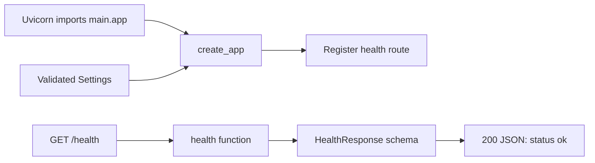

# Dr.Doc

A knowledge assistant being built to answer questions from text-based PDFs and
live public GitHub issues using RAG and MCP.

## Actual status

Checkpoint 1 provides FastAPI, validated configuration, a health endpoint and tests.
Checkpoint 2 adds PostgreSQL connection setup, document/chunk models, and an Alembic
migration with pgvector, applied and tested against Neon PostgreSQL. Live results
are recorded in [database verification notes](docs/database.md). Checkpoint 3 adds
local PDF validation, extraction and chunking. Checkpoint 4 adds a local PDF upload
endpoint, bounded Gemini embeddings and atomic indexing in Neon. Checkpoint 5 adds
document listing/deletion, filtered vector retrieval, grounded Gemini answers and
backend-validated citation IDs. MCP, React, CI/CD and deployment are not implemented.
Neither target resume claim is satisfied yet. Liveness and
routine tests work without external services.

An early [embedding smoke check](docs/embedding-check.md) successfully called
`gemini-embedding-2` for one synthetic sentence and received 768 finite values.
This verifies current provider access and vector shape, not ingestion or retrieval quality.

## Setup and run (PowerShell)

Install uv if it is not already available. From the repository root:

```powershell
cd backend
uv sync --locked
uv run --locked fastapi dev app/main.py
```

Open http://127.0.0.1:8000/health to see `{"status":"ok"}`.
Interactive API documentation is at http://127.0.0.1:8000/docs.
Stop the server with Ctrl+C.

Use uv exclusively for Python dependencies and execution. `uv sync` creates
`backend/.venv/`; no manual environment activation is needed. `uv.lock` records
resolved versions and should be committed. `--locked` rejects an outdated lockfile.
Use `uv add <package>` for future dependencies and `uv add --dev <package>` for
development dependencies. This backend runs directly from its directory and is
not installed as a distributable package, so it needs no build backend or
project egg-info. Python 3.13 is selected in `.python-version`.

## Structure

```text
backend/
  .env.example
  .python-version
  pyproject.toml
  uv.lock
  app/
    __init__.py
    main.py
    config.py
    database.py
    models/
      base.py
      document.py
      chunk.py
    routes/
      __init__.py
      health.py
    schemas/
      __init__.py
      health.py
      pdf.py
    services/
      __init__.py
      pdf_extraction.py
      chunking.py
      pdf_preparation.py
  tests/
    test_health.py
    test_config.py
frontend/
  README.md
docs/
  checkpoints.md
```

Routes handle HTTP requests, schemas describe request/response data, and services
contain application logic. The health endpoint needs no service.
SQLAlchemy models describe database tables; Pydantic schemas describe API data.
See [database setup and design](docs/database.md) for migrations and connection setup.

## Settings

Defaults work without configuration. Optionally copy `backend/.env.example` to
`backend/.env`. Environment variables take precedence over that file.

| Variable | Default | Allowed values |
| --- | --- | --- |
| `DRDOC_APP_NAME` | `Dr.Doc` | Nonempty string |
| `DRDOC_ENVIRONMENT` | `development` | `development`, `test`, `production` |
| `DRDOC_DATABASE_URL` | unset | PostgreSQL URL; remote connections require SSL |
| `DRDOC_GEMINI_API_KEY` | unset | Private Google AI Studio key; Free-tier project only |

Invalid settings and unknown dotenv entries fail validation during startup.
The dotenv path is relative to the backend source, independent of the shell's
working directory. Keep future secrets server-side in ignored environment files
or hosting settings; never put them in chat, Git, logs or frontend builds.

## Current execution path



`main.py` assembles the app. `routes/health.py` handles the request and returns the
schema from `schemas/health.py`. FastAPI serializes it into JSON.
The endpoint proves process liveness only, not database or model readiness.
An app factory allows tests to supply controlled settings.

## Verification

From `backend/`:

```powershell
uv run --locked pytest -q
uv run --locked pytest --run-db -q
```

Tests check the HTTP status/body, environment settings, invalid-value rejection,
and the stable dotenv location. Routine tests skip real database cases; `--run-db`
requires a configured PostgreSQL connection and runs isolated schema tests for
vector search, constraints and deletion. Neither consumes model quota.
No linter or formatter is configured.

## Local PDF preview

From `backend/`:

```powershell
uv run --locked python -m scripts.preview_pdf "C:\path\sample.pdf"
```

Only text-based PDFs are supported. Defaults: 5 MiB, 30 pages, 200,000 extracted
characters, ~500 estimated tokens per chunk with ~75 overlap. No PDF copy,
embeddings or database rows are saved by this command. Token counts use a documented
four-characters-per-token approximation. See [PDF processing](docs/pdf-processing.md)
for limits, scanned-page handling, provenance, tests and extraction limitations.

## Index a PDF locally

From `backend/`, apply migrations with `uv run --locked alembic upgrade head`, then
start the development server. Open http://127.0.0.1:8000/docs and use
`POST /documents` to upload a small public/sample text PDF. The endpoint returns
201 and `status: ready` only after all chunks and vectors commit. Identical bytes
return 409 even with a different filename. There is a 12-chunk ingestion cap and
one active upload per process. Quota/provider failures are explicit; no paid fallback.

This endpoint is for localhost use and is disabled in production mode until
operator protection is agreed. Original PDFs aren't retained. Google receives
extracted chunk text; its Free tier marks inputs as used for product improvement.
See [ingestion design and verification](docs/ingestion.md) for setup, limits, API
errors, compatibility versions and transaction behavior.

## Ask a document question

With the local server running, open http://127.0.0.1:8000/docs. Upload a public text
PDF, list its ID through `GET /documents`, then call `POST /questions`:

```json
{
  "question": "What failure behavior does the architecture describe?"
}
```

Optionally include `"document_ids": ["your-document-uuid"]`. The response distinguishes
`answered`, `no_evidence` and `insufficient_evidence`. Inspect each `[D1]` marker's
filename, page range and source excerpt. Unknown model citation IDs are rejected;
valid IDs alone do not prove factual support. `DELETE /documents/{id}` removes the
document and its chunks from future retrieval.

Answers use Gemini 3.5 Flash-Lite with one bounded attempt and no paid fallback.
Questions are self-contained. The current retrieval cutoff is provisional; provider
failures return explicit errors rather than answers. See [RAG design and verified
evaluation](docs/rag.md) and [actual synthetic results](backend/evaluation/rag_results.json).

## Remaining architecture and boundaries

The backend uses PostgreSQL + pgvector, SQLAlchemy and Alembic, with separate PDF
extraction, chunking, embedding, retrieval and answer services. A real MCP
client will fetch allowlisted public GitHub evidence. Combined questions must
use document and live evidence in one bounded workflow. Final routing behavior
requires review at its checkpoint. Questions are
be self-contained, without reliable conversational memory.

The budget is ₹0. Gemini and Neon are connected and live calls have been verified.
The user confirmed the Gemini project is Free tier; remaining account quotas and
Neon plan limits must be monitored in their consoles. Render, Vercel and GitHub
Actions deployment are still proposed, not configured. Check
official availability, account quotas and data-use policies before integration.
No billing or paid fallback is authorized. Free hosting cold starts and limited
capacity are acceptable. Agree on sample content, operator protection and public
query limits before deployment. See `docs/checkpoints.md` for the sequence.

Database design, ingestion/query flows and current provider configuration are
documented. Broader evaluation, MCP, combined routing, the frontend, CI/CD and
deployment remain unfinished. Current synthetic evaluation is a smoke check,
not a general accuracy benchmark.
