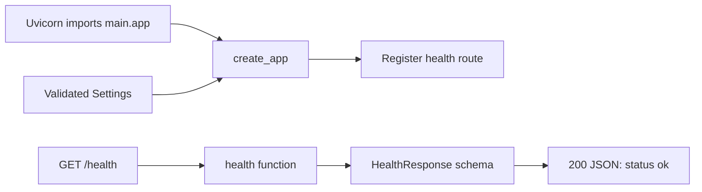

# Dr.Doc

A knowledge assistant being built to answer questions from text-based PDFs and
live public GitHub issues using RAG and MCP.

## Actual status

Only Checkpoint 1 is implemented: FastAPI, validated configuration, a health
endpoint and tests. Database, PDFs, embeddings, answer generation, MCP, React,
CI/CD and deployment are not implemented. Neither target resume claim is
satisfied yet. No API keys or external services are required for this checkpoint.

## Setup and run (PowerShell)

Install uv if it is not already available. From the repository root:

```powershell
cd backend
uv sync --locked
uv run --locked fastapi dev app/main.py
```

Open http://127.0.0.1:8000/health to see `{"status":"ok"}`.
Interactive API documentation is at http://127.0.0.1:8000/docs.
Stop the server with Ctrl+C.

Use uv exclusively for Python dependencies and execution. `uv sync` creates
`backend/.venv/`; no manual environment activation is needed. `uv.lock` records
resolved versions and should be committed. `--locked` rejects an outdated lockfile.
Use `uv add <package>` for future dependencies and `uv add --dev <package>` for
development dependencies. This backend runs directly from its directory and is
not installed as a distributable package, so it needs no build backend or
project egg-info. Python 3.13 is selected in `.python-version`.

## Structure

```text
backend/
  .env.example
  .python-version
  pyproject.toml
  uv.lock
  app/
    __init__.py
    main.py
    config.py
    routes/
      __init__.py
      health.py
    schemas/
      __init__.py
      health.py
    services/
      __init__.py
  tests/
    test_health.py
    test_config.py
frontend/
  README.md
docs/
  checkpoints.md
```

Routes handle HTTP requests, schemas describe request/response data, and services
will contain application logic. The health endpoint needs no service yet.
Database models will be added when we reach Checkpoint 2.

## Settings

Defaults work without configuration. Optionally copy `backend/.env.example` to
`backend/.env`. Environment variables take precedence over that file.

| Variable | Default | Allowed values |
| --- | --- | --- |
| `DRDOC_APP_NAME` | `Dr.Doc` | Nonempty string |
| `DRDOC_ENVIRONMENT` | `development` | `development`, `test`, `production` |

Invalid settings and unknown dotenv entries fail validation during startup.
The dotenv path is relative to the backend source, independent of the shell's
working directory. Keep future secrets server-side in ignored environment files
or hosting settings; never put them in chat, Git, logs or frontend builds.

## Current execution path



`main.py` assembles the app. `routes/health.py` handles the request and returns the
schema from `schemas/health.py`. FastAPI serializes it into JSON.
The endpoint proves process liveness only, not database or model readiness.
An app factory allows tests to supply controlled settings.

## Verification

From `backend/`:

```powershell
uv run --locked pytest -q
```

Tests check the HTTP status/body, environment settings, invalid-value rejection,
and the stable dotenv location. Routine tests make no external service requests
and consume no model quota. No linter or formatter is configured.

## Planned architecture and boundaries

The backend will use PostgreSQL + pgvector, SQLAlchemy and Alembic, with separate
PDF extraction, chunking, embedding, retrieval and answer services. A real MCP
client will fetch allowlisted public GitHub evidence. Combined questions must
use document and live evidence in one bounded workflow. Schema design and final
routing behavior require review at their checkpoints. Questions will initially
be self-contained, without reliable conversational memory.

The budget is ₹0. Gemini, Neon, Render, Vercel and GitHub Actions are proposed
services, not verified account entitlements or configured deployments. Check
official availability, account quotas and data-use policies before integration.
No billing or paid fallback is authorized. Free hosting cold starts and limited
capacity are acceptable. Agree on sample content, operator protection and public
query limits before deployment. See `docs/checkpoints.md` for the sequence.

Database design, ingestion/query flows, provider configuration, MCP, routing,
evaluation, CI/CD and deployment documentation will evolve with implementation;
they are not completed features.
