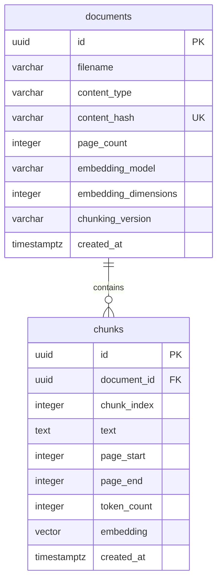

# Checkpoint 2: database foundation

## Responsibilities

- `backend/app/config.py`: reads the private `DRDOC_DATABASE_URL` as a masked secret.
- `backend/app/database.py`: validates PostgreSQL/SSL settings, creates an engine and sessions.
- `backend/app/models/base.py`: shared SQLAlchemy declarative base.
- `backend/app/models/document.py`: document metadata and its chunks relationship.
- `backend/app/models/chunk.py`: passage text, provenance and `vector(768)` embeddings.
- `backend/app/models/__init__.py`: exports the models for migration discovery.
- `backend/alembic.ini`: migration paths, with no database credentials.
- `backend/migrations/env.py`: connects Alembic to settings and model metadata.
- `backend/migrations/script.py.mako`: template for future revisions.
- `backend/migrations/versions/0001_documents_and_chunks.py`: explicit initial schema.
- `backend/tests/test_database_config.py`: offline connection configuration checks.
- `backend/tests/conftest.py`: opt-in isolated real PostgreSQL test setup.
- `backend/tests/test_database_integration.py`: migration, cosine search, constraints,
  filtering, rollback and cascade deletion using synthetic vectors.
- `backend/pyproject.toml` and `backend/uv.lock`: dependencies and resolved versions.
- `backend/.env.example`: safe setup reference. Real `backend/.env` stays outside Git.

## Setup

1. Create a project on Neon Free and confirm the account's actual limits.
2. In Connect, disable connection pooling and copy the direct PostgreSQL URL.
3. Put it into `DRDOC_DATABASE_URL` in `backend/.env`, preserving SSL parameters.
   Copy only the URL, not a `psql` command or surrounding shell syntax.
4. From `backend/`, run:

```powershell
uv sync --locked
uv run --locked alembic upgrade head
uv run --locked alembic current
uv run --locked alembic check
uv run --locked pytest --run-db -q
```

Run migrations once per target database, not on every application import or request.
The health endpoint still works without a database and checks liveness only.

## Schema



IDs are Python-generated UUIDs. Timestamps are database-generated and timezone-aware.
The document hash is unique; `(document_id, chunk_index)` is also unique.
Foreign-key cascade removes chunks when their document is deleted. A regular
`document_id` index supports filtering; no approximate vector index is created.

Vectors have 768 dimensions. Google's documentation lists 768 as a recommended
supported output size for `gemini-embedding-2`. This reduces storage relative to
the 3072 default, with retrieval quality to be evaluated later. The initial schema
accepts only that model name and dimension; a provider change requires a deliberate
migration and re-indexing. Matching vector lengths alone never proves compatibility.
Account-specific model quota remains unverified; no model API is called here.

Page numbers are inclusive, one-based PDF page positions, not printed labels.
Checks reject nonpositive page/token counts, invalid ranges, negative chunk indices
and blank text. Future ingestion must also verify that chunk page ranges fit within
their parent document's page count. Cross-table validation is not a simple CHECK
constraint and is not implemented in this checkpoint.

Chunk size remains a proposed ~500 tokens with ~75 overlap, to be implemented and
evaluated later. The token counting method is not chosen yet. No PDF binaries or
processing jobs are stored. No pending status or conversation tables are introduced.

## Execution and transactions

Alembic loads settings, builds a psycopg-backed SQLAlchemy engine, connects, and
runs the revision. The revision enables pgvector in `public`, creates `documents`
and `chunks`, adds their constraints/index, and records revision `0001`.

We use synchronous SQLAlchemy for straightforward transaction ownership. Future
blocking database operations must run in synchronous FastAPI handlers/dependencies
or a worker thread, not block an async event loop. `NullPool` closes connections
after use, trading connection setup overhead for avoiding idle application pools.
Connections have a 10-second connect timeout and 15-second statement timeout.
No query polling or automatic retry loop keeps Neon active.

`create_database_engine()` does not connect until a connection/session is used.
`create_session()` returns a session whose caller owns its context and transaction.
Future ingestion will extract and embed before starting its short write transaction,
then insert the document and chunks atomically. That ingestion service is not built yet.

The migration downgrade drops both tables and their data, but leaves the potentially
shared pgvector extension installed. Do not run it against data you want to preserve.

## Tests and limits of evidence

Routine `uv run --locked pytest -q` runs offline tests and explicitly skips the
database cases. `--run-db` opts into real PostgreSQL with the configured connection.
Each integration test runs the migration in a unique transactional schema. Rollback
removes the test schema and data; existing application tables are not dropped.
Tests store public synthetic text and hand-created unit vectors only. They verify
database vector operations, not Gemini embeddings or semantic retrieval quality.

Relevant official references:

- [Neon pricing](https://neon.com/pricing): advertised Free allowance, not account verification.
- [Neon pgvector](https://neon.com/docs/extensions/pgvector): availability and enabling the extension.
- [SQLAlchemy psycopg dialect](https://docs.sqlalchemy.org/en/20/dialects/postgresql.html#module-sqlalchemy.dialects.postgresql.psycopg)
- [Alembic tutorial](https://alembic.sqlalchemy.org/en/latest/tutorial.html)
- [pgvector Python](https://github.com/pgvector/pgvector-python): SQLAlchemy vector operations.
- [Gemini embeddings](https://ai.google.dev/gemini-api/docs/embeddings): model and dimensions.

Neon holds any rows written to it in the selected cloud region. This checkpoint uses
only synthetic test data. Use only public/sample document content later and review
provider privacy/data-use terms before ingestion or model calls. No billing or
paid services are enabled by this implementation.

## Verified results — 19 October 2026

The user's console query confirmed PostgreSQL 18.6. Using the private direct URL:

| Command from `backend/` | Actual result |
| --- | --- |
| `uv run --locked alembic upgrade head` | Completed successfully on Neon |
| `uv run --locked alembic current` | `0001 (head)` |
| `uv run --locked alembic check` | No new upgrade operations detected |
| `uv run --locked pytest -q` | 10 passed, 13 explicitly skipped |
| `uv run --locked pytest --run-db -q` | 23 passed |

The initial integration run emitted an Alembic path-separator deprecation warning;
the configuration now explicitly sets `path_separator = os`.
These results verify database storage/vector operations only, not PDF ingestion,
embedding API access, answer quality, or application deployment. No model calls
were made. Neon account plan/remaining allowance still needs console confirmation.
