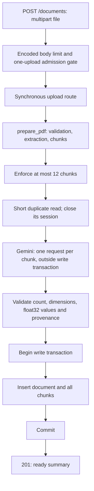

# Checkpoint 4: embeddings and atomic ingestion

## Implemented behavior

`POST /documents` accepts one multipart field named `file` and returns `201` with
a ready document summary only after committing the document and every chunk.
Multiple documents can be indexed through separate requests. No original binary
is retained. Listing, deletion and question answering endpoints come later.

This endpoint is for local development. Keep the server bound to `127.0.0.1`.
It has no operator authentication yet and is disabled when
`DRDOC_ENVIRONMENT=production`. Before public deployment we must agree on operator
protection, sample corpus and query limits. CORS is not authentication.

## Request flow



The synchronous route runs through FastAPI's worker-thread support, so synchronous
PDF/SDK/database work doesn't block the async server event loop. It is not a durable
job queue. Losing the request/process before commit can lose the ingestion work.

## Embedding compatibility

- Model: `gemini-embedding-2`.
- Dimensions: 768, matching `vector(768)`.
- Document input: `title: none | text: {chunk text}`.
- Input format version: `gemini2-retrieval-v1`.
- Future query retrieval must use the corresponding Gemini 2 task-prefixed query
  formatting (for question answering: `task: question answering | query: {question}`).

Google recommends these asymmetric document/query formats for Embedding 2; its
older `task_type` field is not supported for this model. Multiple content inputs
can be aggregated into one vector, so we send one chunk per call. The original
document filename is citation metadata, not an embedding instruction/title.

Migration `0002` adds `documents.embedding_input_version`. Existing rows receive
`legacy-unversioned`, rather than being falsely marked as compatible. New ingestion
explicitly writes `gemini2-retrieval-v1`. Future retrieval must exclude incompatible
model/dimension/input-format combinations. Changing these requires re-indexing.

Provider responses are checked for one vector per call, 768 finite numeric values,
float32 representability, and nonzero norm after float32 conversion. This verifies
shape and numeric usability, not semantic quality or factual correctness.

## Bounds and failure behavior

| Guard | Behavior |
| --- | --- |
| PDF limits | Existing 5 MiB, 30 pages, 200,000 raw extracted characters and stream limits |
| Encoded HTTP body | 5 MiB + 64 KiB multipart overhead, checked before multipart parsing; includes streamed bodies |
| Upload admission | One active upload per backend process; additional requests receive 503 |
| Per-upload chunk cap | 12; larger preparations receive 422 before model calls |
| SDK attempts | One per chunk, no retry loop or paid fallback |
| Per-call timeout | At most 15 seconds, reduced to the remaining embedding budget |
| Embedding budget | 60 seconds; checked before/after calls; expires before writes |
| Database | Existing 10-second connect and 15-second statement timeouts |

The 60-second budget covers the embedding stage, not the whole request. Transport
timeouts are SDK timeouts, not a hard process kill deadline. PDF parsing and slow
upload clients still require deployment-level timeout/resource controls before
public exposure. The one-upload gate is per process, not distributed rate limiting.
FastAPI's multipart parser may temporarily spool bytes to disk; the request closes
the uploaded file and no original is retained as application storage.

Responses use a consistent `detail` object with `code` and `message`:

| Status | Example |
| --- | --- |
| 201 | All document/chunk rows committed; ready summary |
| 409 | Identical PDF bytes already indexed, including under another filename |
| 413 | PDF or encoded request too large |
| 422 | Invalid/scanned/encrypted PDF, chunk cap, missing file |
| 502 | Invalid provider vectors or count |
| 503 | Quota, provider/network failure, upload busy, storage unavailable, production uploads disabled |

A quota response includes `Retry-After: 60` as a suggestion, not a promise that
quota will reset then. Actual daily/project limits must be checked in AI Studio.
Provider messages, keys, PDF text and vectors aren't included in error responses.

The duplicate precheck avoids unnecessary embedding calls. The database's unique
hash constraint remains authoritative if two processes race after the precheck.
That race can consume redundant provider calls but cannot create duplicate rows.

No replacement endpoint exists: duplicates are rejected. Failed new ingestion
doesn't delete or modify an existing document. Failures before writes store nothing;
write failures roll back the new document/chunks together. A lost commit
acknowledgement can make outcome uncertain, so storage errors don't claim success.
Retrying the same bytes then either succeeds or reports a duplicate.

## Use locally

The Free-tier key and Neon URL are already configured privately in `backend/.env`.
Use only public/sample PDFs: Google's current Free-tier pricing table marks inputs
as used for product improvement. Extracted chunk text goes to Google and is stored
with vectors in Neon; original PDF bytes are not sent to Google's Files API.
Never enable billing or add paid fallback models for this project.

From `backend/`:

```powershell
uv sync --locked
uv run --locked alembic upgrade head
uv run --locked fastapi dev app/main.py
```

Open http://127.0.0.1:8000/docs, expand `POST /documents`, click Try it out, select
a small public text PDF, then Execute. A successful response includes the UUID,
filename, page/chunk counts, model/dimension/input version, chunking version, timestamp,
warnings and `status: ready`. Uploading the same bytes again returns 409.
This really consumes one embedding request per chunk; routine automated tests do not.

## Files changed in this checkpoint

- `backend/app/services/embeddings.py`: provider calls, compatibility constants,
  time/attempt limits and vector validation.
- `backend/app/services/ingestion.py`: preparation, duplicate check, embedding and
  atomic database write orchestration.
- `backend/app/schemas/documents.py`: ready response contract.
- `backend/app/routes/documents.py`: multipart upload, dependency setup and error mapping.
- `backend/app/upload_limits.py`: pre-parser request size and concurrency guards.
- `backend/app/main.py`: registers the route and upload middleware.
- `backend/app/models/document.py`: embedding input-format metadata.
- `backend/migrations/versions/0002_embedding_input_version.py`: additive migration.
- `backend/tests/test_embeddings.py`: mocked SDK behavior and invalid-vector handling.
- `backend/tests/test_document_api.py`: upload contract and HTTP failures.
- `backend/tests/test_ingestion_integration.py`: real PostgreSQL ingestion/rollback cases.
- `backend/tests/test_ingestion_live.py`: explicit opt-in single-request live smoke test.
- `backend/tests/test_upload_limits.py`: streamed-body cap and admission guard.
- `backend/tests/conftest.py`: adds explicit live-call test opt-in.
- `backend/tests/test_database_integration.py`: expects migration head `0002`.
- `README.md`, `docs/checkpoints.md`, `docs/database.md`, this document: current setup/status.

## Verification

From `backend/`:

```powershell
uv run --locked pytest -q
uv run --locked pytest --run-db -q
```

Routine tests mock Google. Real database tests migrate unique temporary schemas
and roll back all test data, preserving application tables. The ingestion tests
exercise the HTTP endpoint with two generated PDFs, vector/provenance storage,
duplicate detection before provider calls, race-time uniqueness, provider failure
preserving existing data, and a forced chunk-write failure rolling back the new
document after its row has already been inserted.

An optional live test makes exactly one real embedding call on synthetic content:

```powershell
uv run --locked pytest tests/test_ingestion_live.py --run-db --run-live-embedding -q
```

This opt-in test also uses a temporary schema; its database rows are rolled back.
Its outer test transaction remains open for isolation while the provider is called;
the application itself does not hold a database transaction across provider calls.
This exception is test infrastructure, not the production ingestion pattern.

## Actual results — 19 October 2026

| Command | Actual result |
| --- | --- |
| `uv run --locked alembic upgrade head` | Applied revision 0002 to Neon |
| `uv run --locked alembic current` | `0002 (head)` |
| `uv run --locked alembic check` | No new upgrade operations detected |
| `uv run --locked pytest --run-db --run-live-embedding -q` | 97 passed in 34.66 seconds |
| `git diff --check` | No whitespace errors |

The final suite included all current tests, 20 real PostgreSQL test cases and one
explicitly enabled live Gemini ingestion case. The live case generated a single
chunk from a public synthetic sentence and made one provider request. Its 768-value
vector and document metadata were stored and inspected in a temporary schema, then
rolled back. No persistent sample corpus was added by the test.

This checkpoint does not establish retrieval relevance, grounded answers, or
completion of either resume claim. Tests demonstrate the bounded ingestion path;
account quota is finite and availability can change.

Official references:

- [Gemini 2 input formatting and aggregation](https://ai.google.dev/gemini-api/docs/embeddings)
- [Free-tier pricing and data use](https://ai.google.dev/gemini-api/docs/pricing)
- [FastAPI file uploads](https://fastapi.tiangolo.com/tutorial/request-files/)
