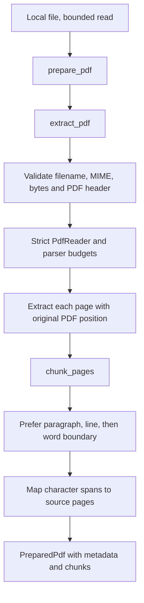

# Checkpoint 3: PDF preparation

## Actual scope

Implemented local PDF validation, page-by-page text extraction, paragraph-aware
chunking, provenance, and a preview command. No upload endpoint, embeddings or
database writes are part of this checkpoint. Original bytes exist only during
processing; the service doesn't save them. Reprocessing later requires re-uploading.
There is no background job, durable queue or OCR implementation.

## Files and responsibilities

- `backend/app/schemas/pdf.py`: immutable extracted-page, PDF, chunk and preparation contracts.
- `backend/app/services/pdf_extraction.py`: filename/type/size validation, parsing,
  page/stream/text limits, extraction, hash generation, warnings and safe errors.
- `backend/app/services/chunking.py`: text windows, boundary preference, estimated
  token counts, overlap and page mapping.
- `backend/app/services/pdf_preparation.py`: composes extraction and chunking.
- `backend/scripts/preview_pdf.py`: bounded local-file preview; prints counts and
  provenance, not extracted text.
- `backend/tests/pdf_fixtures.py`: creates small synthetic PDF bytes in memory.
- `backend/tests/test_pdf_extraction.py`: validates actual generated PDF inputs.
- `backend/tests/test_chunking.py`: boundaries, overlap, estimates and page ranges.
- `backend/tests/test_pdf_preparation.py`: full preparation path and preview CLI.
- `backend/pyproject.toml`, `backend/uv.lock`: add and lock pypdf via uv.
- `README.md`, `docs/checkpoints.md`, this document: current behavior and usage.
- `docs/embedding-check.md`: records that the previously pending mocked tests ran.

## Flow



Extraction and chunking are independent functions. Future ingestion can call the
same `prepare_pdf()` function before generating embeddings and opening its write
transaction. The existing `/health` endpoint is unchanged.

## Initial limits

| Limit | Default |
| --- | --- |
| PDF bytes | 5 MiB (5,242,880 bytes) |
| Pages | 1–30 |
| Raw extracted characters | 200,000 across the document |
| Decoded page content stream | 2 MiB |
| Total decoded page content streams | 8 MiB |

`PdfLimits` permits explicit overrides in code and tests. pypdf's context-local
configuration also bounds several decompression/parser operations; no global
per-request configuration is mutated. These are resource guards, not a hard CPU
deadline or a complete sandbox for hostile documents. Broader public upload access
requires reassessing parser isolation and request/concurrency limits before deployment.

Filename and MIME checks do not establish parseability: a PDF header and successful
parsing/extraction are also required. Display filenames have path components removed.
Password-protected PDFs are rejected rather than decrypted.

## Text-only behavior

Each page retains its one-based PDF position. The extractor normalizes horizontal
whitespace and repeated blank lines while retaining line/paragraph boundaries.
It doesn't reconstruct tables, remove headers, fix reading order, dehyphenate words
or infer headings. Strict parsing can reject PDFs a forgiving viewer can display.

A document with no readable text is rejected. A page with no readable text and
detectable images is rejected as image-only, including inside a mixed document.
Other pages without readable text are omitted from chunks with explicit warnings.
Blank pages remain represented in the extracted page list so numbering never shifts.

This isn't a perfect scan detector: a scanned page with an existing OCR text layer
may be accepted; text quality isn't guaranteed. Image content on a page that also
has text is not interpreted. pypdf does not perform OCR, and we do not execute PDF
scripts or treat extracted instructions as authorized application actions.

## Chunking and token estimates

Defaults are `target_tokens=500`, `overlap_tokens=75`. For now, one estimated token
equals four Unicode characters, yielding windows of at most 2,000 characters and
300-character overlap before trimming. This is an English-oriented approximation,
not a Gemini tokenizer or a provider context-limit guarantee. It can be inaccurate
for code, non-Latin scripts and punctuation-heavy text. Exact provider budgeting
will be considered when constructing embedding/answer requests.

We prefer the last paragraph boundary in the latter half of a window, then a line
boundary, then a space. If none is available, we cut at the character limit. This
means chunks may be shorter than the target, and long words or overlap starts can
be split. Whitespace trimming can slightly reduce the retained overlap. These
tradeoffs keep the first implementation deterministic and understandable.

The concatenated text has a character-span map for each nonempty source page.
After choosing and trimming a chunk, we find the page spans it intersects. This
produces accurate inclusive `page_start`/`page_end`; it never guesses page numbers
from generated text. A chunk may span page 1 to page 3 with a blank page 2 between.
These are source page ranges, not exact text bounding boxes or printed page labels.

`token_count` is `ceil(len(chunk.text) / 4)`, labeled
`characters-divided-by-4-v1` in the preparation contract. The chunking version is
`char4-v1-target500-overlap75`, which will be stored in document metadata during
future ingestion. The database column name remains `token_count`; its estimated
meaning is documented rather than presented as a precise provider measurement.

## Try it

From `backend/`, use a local, text-based sample PDF:

```powershell
uv run --locked python -m scripts.preview_pdf "C:\path\sample.pdf"
```

Expected output lists the page count, character count, chunk count, warnings and
each chunk's page range and estimated token count. It performs no network request
and requires neither a model key nor a database connection.

Rejected inputs print a stable code and useful message, for example:

```text
Rejected [image_only_page]: Page 1 is image-only with no readable text. OCR is not supported.
```

## Verification — 19 October 2026

```powershell
uv run --locked pytest -q
```

Actual result: **51 passed, 13 skipped**. The skipped cases are the opt-in real
PostgreSQL tests, already verified in Checkpoint 2; database code did not change.
This run also executed the previously pending mocked embedding-probe tests.

The PDF tests use real in-memory PDFs generated with pypdf. They cover valid
multi-page PDFs, invalid types/headers/parseability, empty/encrypted files,
size/page/text/stream limits, compressed stream expansion, image-only/mixed PDFs,
blank pages, chunk boundaries, cross-page provenance, deterministic overlap and
the CLI preparation flow. No model calls or database writes were made.

This is synthetic-fixture verification, not retrieval evaluation or a claim that
all real-world PDF layouts extract correctly. Representative public PDFs still
need evaluation when the ingestion/retrieval workflow exists.

References:

- [pypdf text extraction](https://pypdf.readthedocs.io/en/stable/user/extract-text.html)
- [Strict parsing tradeoffs](https://pypdf.readthedocs.io/en/stable/user/robustness.html)
