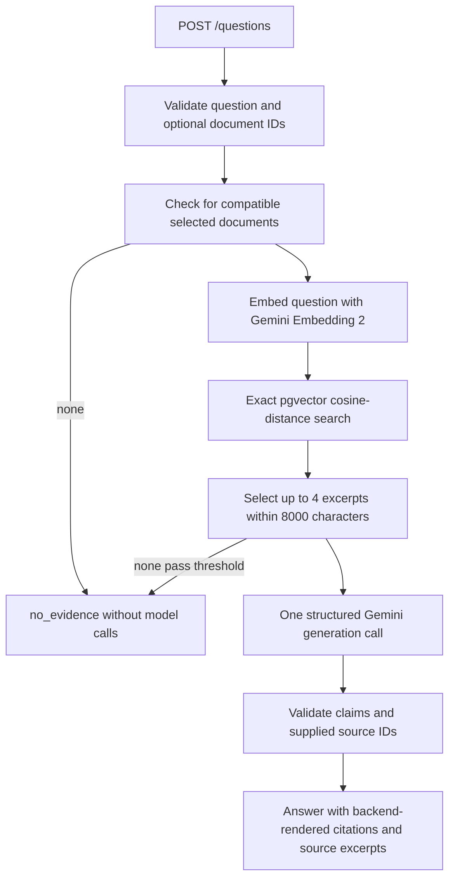

# Checkpoint 5: document RAG

## Scope

Implemented the local backend RAG path, plus document listing and deletion:

- `GET /documents`: up to 50 recent document summaries, with an explicit `truncated` flag.
- `POST /documents`: existing PDF ingestion.
- `DELETE /documents/{id}`: delete the document and its chunks atomically; 204 or 404.
- `POST /questions`: a self-contained question with optional document UUID filtering.

No frontend, conversation memory, MCP, routing across evidence types, deployment or
public-access protection is implemented. Keep the development server on localhost.
Queries and document operations are disabled in production mode until deployment
access and quota boundaries are agreed. Neither resume claim is complete.

## Question flow



Short database sessions close before embedding/generation calls. Tests check those
application transaction boundaries. No background tasks, autonomous loops or tool
calls are used. The synchronous route runs through FastAPI's worker-thread handling.

## Embedding compatibility and retrieval

Question embeddings use `gemini-embedding-2`, 768 dimensions and the documented
query prefix `task: question answering | query: {question}`. Documents use
`title: none | text: {chunk}`. Retrieval filters all three compatibility fields:
model, dimensions and `gemini2-retrieval-v1` input version. Legacy/unversioned
vectors are excluded. No re-indexing or model change occurs in this checkpoint.

Search is exact cosine distance without an approximate vector index. It considers
up to 8 candidates with distance <= 0.60, then selects up to 4 distinct passage
texts within 8000 excerpt characters. The cutoff is an initial heuristic, not a
calibrated relevance probability. It can miss useful evidence or admit irrelevant
passages. Chunk overlap can also produce redundant context; exact-text duplicates
are removed, but no advanced reranker or overlap-merging algorithm is introduced.

Question length is capped at 1500 characters and filters at 10 UUIDs. An omitted
filter searches all compatible documents; an explicit empty list is rejected to
avoid accidentally broadening a user's selection. Unknown/deleted IDs produce no
matching evidence. Each question is self-contained; history is not accepted.

## Generation and citations

The answer model is `gemini-3.5-flash-lite`, advertised with a Free tier and
recommended for new projects by Google's current model guidance. Account access
was tested with the user's existing confirmed Free-tier key. Availability and
remaining quota can change; no paid model or billing upgrade is configured.

Generation sends a system instruction separately from a JSON payload containing
the question and evidence. PDF text, filenames and questions are untrusted data;
they cannot authorize tools or change permissions. No tools are supplied to the
model. This prompt boundary helps resist injection but is not a proof that a model
will never follow malicious text or produce unsupported claims.

The model returns JSON with either:

- `answered`: 1–6 claims, each containing plain text and supplied source IDs.
- `insufficient_evidence`: no claims.

The backend assigns `D1`, `D2`, etc. after retrieval. It rejects unknown source IDs,
inconsistent/empty answers, inline bracketed citations and model-provided links.
It appends the validated markers itself and maps IDs to the original document UUID,
chunk UUID, filename, PDF page range and exact excerpt sent to the model. Models
cannot supply or overwrite those metadata fields.

Valid citation IDs prove only source membership. They do not prove a claim is
entailed by its excerpt. Inspect supporting text and evaluate answer support
separately. On abstention, sources are returned as retrieved evidence for inspection,
not as citations supporting a factual answer.

The request uses `response_json_schema=GeneratedAnswer.model_json_schema()` and
validates returned text again with Pydantic. The SDK's alternate `response_schema`
conversion initially produced an API-rejected `additional_properties` field; explicit
JSON Schema fixed that integration issue. Blocked, incomplete, malformed or missing
responses are failures, not unsupported-question answers.

## Budgets and errors

| Boundary | Limit/behavior |
| --- | --- |
| Encoded question body | 16,000 bytes before JSON parsing |
| Active queries | One per backend process; independent of the upload slot |
| Question embedding | One attempt, 15-second SDK timeout |
| Evidence | At most 4 excerpts, 8000 excerpt characters |
| Generation payload | At most 20,000 characters including question and metadata |
| Answer generation | One attempt, 45-second SDK timeout, max 1800 output tokens |
| Model tools | None |
| Retry/fallback | No automatic retry or paid fallback |

Character limits are explicit local budgets, not exact Gemini token counts.
System instructions are separate and bounded in source. These limits are far
below the documented model input context size. Timeouts are SDK request timeouts,
not a hard whole-process deadline. Public deployment still needs agreed traffic
controls, request timeouts and operator protection; this is not distributed rate limiting.

Successful HTTP 200 responses distinguish:

- `answered`: generated claims passed structural and citation-ID validation.
- `no_evidence`: no compatible selected documents, or no chunk met the retrieval cutoff.
- `insufficient_evidence`: retrieved text was available, but the model abstained.

Failures use HTTP errors with safe `detail.code` / `detail.message`:

- 413: oversized encoded request.
- 422: invalid question/filter or excessive context.
- 502: invalid citations, malformed/blocked/incomplete model output.
- 503: provider/quota/retrieval failure, busy query slot or disabled production access.

Quota failures suggest `Retry-After: 60`; that does not guarantee a reset then.
No failed provider request is silently turned into an answer or no-evidence status.
Keys, raw provider errors and database parameters are not returned by the API.

## Try the complete backend

From `backend/`:

```powershell
uv sync --locked
uv run --locked alembic upgrade head
uv run --locked fastapi dev app/main.py
```

Open http://127.0.0.1:8000/docs:

1. Index a small public/sample text PDF through `POST /documents`.
2. Use `GET /documents` to obtain its UUID.
3. Send `POST /questions`:

```json
{
  "question": "What cache failure behavior does this document describe?"
}
```

Optionally include `"document_ids": ["the-document-uuid"]`. Inspect the answer's
`[D1]` markers alongside its `sources` array: filename, page range and excerpt.
Delete through `DELETE /documents/{id}`; future retrieval will exclude that content.
An answer already returned to a client is not retroactively revoked by deletion.

Use only public/sample material. Google marks Free-tier inputs as used for product
improvement; both questions and retrieved excerpts are sent to Google. Neon stores
chunk text/vectors; no original PDF binaries or conversation history are retained.

## Files

- `app/schemas/questions.py`: question, claim, source, model-output and response contracts.
- `app/services/embeddings.py`: adds compatible question embeddings.
- `app/services/retrieval.py`: exact vector search, filters, cutoff and evidence budget.
- `app/services/answers.py`: bounded structured generation and safe errors.
- `app/services/rag.py`: orchestration, abstention and citation-ID mapping.
- `app/routes/questions.py`: question endpoint and dependency assembly.
- `app/services/documents.py`: catalog listing and atomic cascade deletion.
- `app/schemas/documents.py`, `app/routes/documents.py`: add listing/deletion contracts/routes.
- `app/upload_limits.py`: adds question-body bounds and a per-process query slot.
- `app/main.py`: registers question routes.
- `scripts/check_answer_model.py`: explicit synthetic provider diagnostic; never run in routine tests.
- `tests/rag_helpers.py`: source/vector/database fixture helpers.
- `tests/test_rag.py`: orchestration, citation and abstention tests.
- `tests/test_answer_provider.py`: mocked query embeddings, generation schema/errors and prompt boundaries.
- `tests/test_question_api.py`: HTTP contracts and input/body validation.
- `tests/test_retrieval_integration.py`: real pgvector selection, context bounds, deletion and sessions.
- `tests/test_rag_live.py`: opt-in end-to-end synthetic evaluation.
- `tests/conftest.py`: adds `--run-live-rag` opt-in.
- `evaluation/rag_results.json`: actual latest synthetic evaluation output, not invented metrics.
- `README.md`, `docs/checkpoints.md`, this document: current status and usage.

All paths above are relative to `backend/`, except root documentation paths.
No new dependencies or migrations were required.

## Evaluation

Routine tests mock Google. Real PostgreSQL tests run in isolated schemas and roll
back their data. Live evaluation is explicitly opt-in:

```powershell
uv run --locked pytest --run-db -q
uv run --locked pytest tests/test_rag_live.py --run-db --run-live-rag -q
```

The live set uses two generated public synthetic PDFs: Redis TTL/fallback behavior
and a two-maintainer release policy. It separately checks expected facts, source-ID
mapping, document filtering, unsupported-question abstention and post-deletion
retrieval. It does not establish broad retrieval precision, entailment accuracy or
robustness against prompt injection. No MCP/live-GitHub cases are implemented yet.

## Actual verification — 21 October 2026

| Command | Actual result |
| --- | --- |
| `uv run --locked pytest --run-db -q` | 128 passed, 2 live-provider tests skipped |
| `uv run --locked pytest tests/test_rag_live.py --run-db --run-live-rag -q` | 1 passed in 35.33 seconds |
| `git diff --check` | No whitespace errors |

The successful live run indexed two generated PDFs and asked three questions. It
made two ingestion embedding calls, three query embedding calls and three generation
calls. All temporary database rows were rolled back. The JSON report contains the
actual returned answers and evidence; its UUIDs belong to temporary test rows and
cannot be used against the application corpus afterward.

| Evaluation aspect | Observed result |
| --- | --- |
| Retrieval of answerable content | Redis evidence returned at distance ~0.227; release-policy evidence ~0.172, with requested document filters |
| Answer support | Manual comparison found the returned 45-second TTL, PostgreSQL fallback and two-maintainer requirement explicitly stated in cited excerpts |
| Citation correctness | Returned markers mapped to the expected document, original excerpt and PDF page ranges; invalid-ID rejection is separately covered by mocked tests |
| Abstention | CEO birth-date question returned `insufficient_evidence`, not a fabricated date |
| Deletion | Subsequent filtered question returned `no_evidence` after deletion |

The unsupported question's distance was ~0.454, below the 0.60 cutoff, despite its
excerpt not answering the question. This demonstrates a limitation of the initial
threshold: generation abstention is still essential. These observations are not
aggregate retrieval/faithfulness accuracy metrics and should not be generalized
from three synthetic questions. Larger public-document evaluation remains later work.

The first live attempt exposed an SDK schema-field incompatibility, corrected by
using explicit JSON Schema. A short diagnostic also encountered a provider deadline;
the final request timeout is 45 seconds with no automatic retries. Failed attempts
were not counted as successful evaluation results. Actual account access succeeded
at verification time, not a promise of future quota or availability.

Official references checked on 21 October 2026:

- [Gemini pricing](https://ai.google.dev/gemini-api/docs/pricing#gemini-3.5-flash-lite)
- [Current model access guidance](https://ai.google.dev/gemini-api/docs/deprecations)
- [Embedding query/document formats](https://ai.google.dev/gemini-api/docs/embeddings)
- [Structured output](https://ai.google.dev/gemini-api/docs/structured-output)
